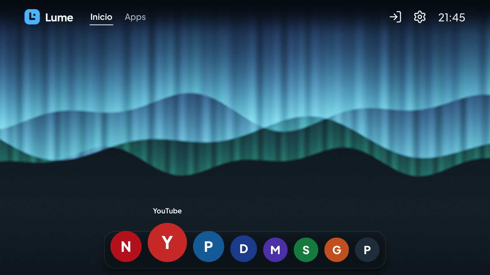
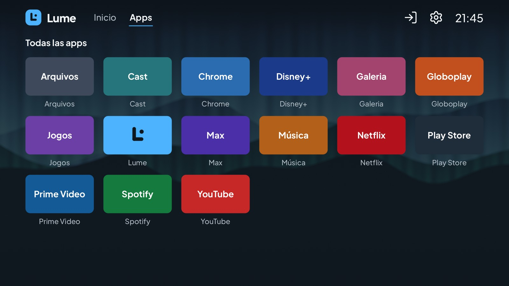
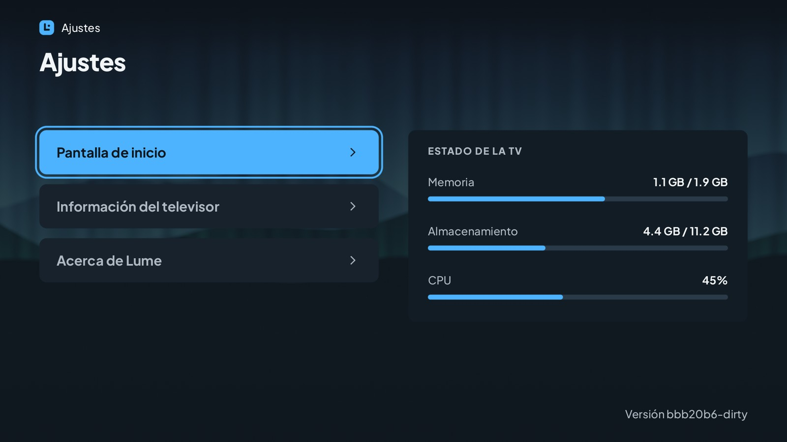
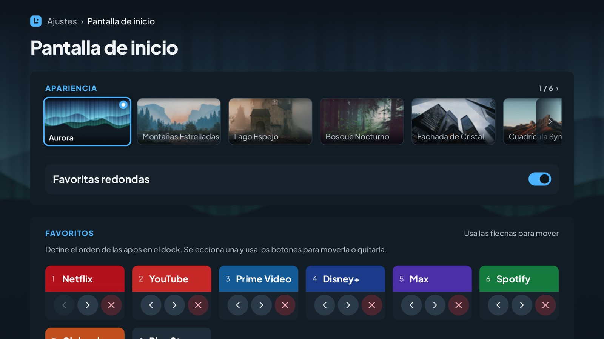

# Lume - Android TV Launcher

**Una pantalla de inicio rápida y ligera para Android TV.** Lume reemplaza el launcher que venía con tu TV por uno sencillo, pensado para el control remoto, que usa muy poca memoria y deja más para tus apps de streaming.

[English](README.md) | [Português (Brasil)](README.pt-BR.md) | Español | [Bahasa Indonesia](README.id.md) | [Русский](README.ru.md)

> **Estado:** Lume está en desarrollo. La versión actual es la **0.3.1**, publicada en la [página de Releases](https://github.com/douglaspands/lume-tv-launcher/releases). Los pasos de abajo muestran cómo instalarla.

<p align="center">
  
  
</p>
<p align="center">
  
  
</p>

**Qué obtienes**

- Una pantalla de inicio con un dock flotante para tus apps favoritas: el ícono con el foco crece y los vecinos le hacen espacio. Los favoritos son redondos, o cuadrados si lo prefieres.
- Seis fondos de pantalla para elegir (la aurora boreal es el predeterminado), hechos para este proyecto.
- Una pantalla "Apps" con todo lo instalado en tu TV.
- Todo funciona con el control remoto normal (flechas, OK, Atrás, Inicio).
- Inglés, portugués (Brasil), español, indonesio y ruso, según el idioma de tu TV.
- Sin acceso a internet: Lume nunca se conecta a la red y no pide permisos peligrosos.

**Qué necesitas**

- Una TV con **Android TV 9, 10 u 11**.
- Un ordenador (Windows, macOS o Linux) en la **misma red Wi-Fi** que la TV.
- Unos 10 minutos.

---

## Instalar Lume en tu TV

Enviarás la app desde el ordenador a la TV con una herramienta pequeña llamada **adb**. Solo tienes que hacerlo una vez.

### 1. Descarga Lume

1. Abre la [página **Releases**](https://github.com/douglaspands/lume-tv-launcher/releases) de este proyecto en GitHub.
2. En la versión más reciente, descarga el archivo con un nombre parecido a **`lume-0.3.1.apk`**.
3. Anota dónde lo guardaste (por ejemplo, la carpeta Descargas).

### 2. Instala adb en el ordenador

1. Descarga las **SDK Platform-Tools** de Google para tu sistema desde <https://developer.android.com/tools/releases/platform-tools>.
2. Descomprímelas en una carpeta fácil, por ejemplo `C:\platform-tools` en Windows o `~/platform-tools` en macOS/Linux.
3. Abre una terminal en esa carpeta:
   - **Windows:** abre la carpeta, haz clic en la barra de direcciones, escribe `cmd` y pulsa Intro.
   - **macOS:** abre *Terminal*, escribe `cd ~/platform-tools` y pulsa Intro.
   - **Linux:** abre una terminal y escribe `cd ~/platform-tools`.

Para comprobarlo, escribe `adb version` (en Windows) o `./adb version` (en macOS/Linux). Debe aparecer un número de versión.

> En macOS y Linux pon `./` delante de cada comando `adb` de abajo (por ejemplo, `./adb devices`).

### 3. Activa la depuración en la TV

1. En la TV, abre **Ajustes → Preferencias del dispositivo → Acerca de**.
2. Selecciona **Compilación** (o *Compilación de Android TV OS*) y pulsa OK **7 veces**, hasta que diga que eres desarrollador.
3. Vuelve a **Preferencias del dispositivo → Opciones de desarrollador**.
4. Activa la **Depuración por USB** y también la **Depuración de red** / **Depuración ADB por red**, si aparece.

Los nombres de los menús cambian un poco entre marcas de TV.

### 4. Averigua la dirección de la TV

En la TV abre **Ajustes → Red e Internet**, selecciona tu conexión y anota la **dirección IP**, algo como `192.168.1.50`.
(Algunas TV también la muestran en *Opciones de desarrollador*, junto al interruptor de depuración de red.)

### 5. Conecta e instala

En la terminal que abriste en el paso 2, escribe (cambia la dirección por la tuya):

```
adb connect 192.168.1.50:5555
```

En la TV aparecerá un mensaje que pregunta *"¿Permitir la depuración por USB?"*. Elige **Permitir siempre** y **OK**. Luego ejecuta el mismo comando otra vez y comprueba que la TV aparece en la lista:

```
adb devices
```

Debes ver tu TV con la palabra `device` al lado. Ahora instala Lume (usa la ruta real del archivo que descargaste):

```
adb install "C:\Users\Usuario\Downloads\lume-0.3.1.apk"
```

Cuando veas `Success`, Lume está instalado.

### 6. Haz de Lume tu pantalla de inicio

1. Pulsa el botón **Inicio** del control remoto. Android puede preguntar qué app usar como pantalla de inicio: elige **Lume** y **Siempre**.
2. Si no preguntó nada, o si Inicio sigue abriendo el launcher antiguo, ejecuta:

   ```
   adb shell cmd package set-home-activity app.lume.tv/.LumeActivity
   ```

3. Algunas TV lo ignoran y siguen abriendo su propio launcher. Como último recurso puedes desactivar el launcher original (no se borra y puedes volver a activarlo):

   ```
   adb shell pm disable-user --user 0 com.google.android.tvlauncher
   ```

### Volver al launcher original

Quita Lume y, si desactivaste el launcher original, vuelve a activarlo:

```
adb shell pm enable com.google.android.tvlauncher
adb uninstall app.lume.tv
```

### ¿Algo salió mal?

| Problema | Qué probar |
|---|---|
| `adb: command not found` / `'adb' no se reconoce` | No estás en la carpeta platform-tools. Abre la terminal dentro de ella (paso 2). |
| `failed to connect` / `unable to connect` | Comprueba la dirección de la TV, que la TV y el ordenador estén en la misma red y que la depuración esté activada. Prueba a apagar y encender la TV. |
| `device unauthorized` | Mira la pantalla de la TV y acepta el aviso; luego ejecuta `adb devices` otra vez. |
| `INSTALL_FAILED_OLDER_SDK` | Tu TV tiene un Android anterior al 9. Lume no puede funcionar en ella. |
| `INSTALL_FAILED_UPDATE_INCOMPATIBLE` | Hay otra compilación de Lume instalada. Ejecuta `adb uninstall app.lume.tv` e instala de nuevo. |
| Inicio abre el launcher antiguo | Repite el paso 6, opciones 2 y 3. |

---

## Para desarrolladores

Lume está escrito en Rust. Dibuja toda su interfaz con OpenGL ES 2.0 (sin Views, WebView, AndroidX ni Kotlin) y libera toda la memoria de la GPU mientras otra app está en primer plano.

### Estructura del repositorio

| Ruta | Contenido |
|---|---|
| `crates/lume-css` | Analizador del subconjunto de CSS que usan los temas (ver [`docs/theme-format.md`](docs/theme-format.md)) |
| `crates/lume-strings` | Convierte las traducciones `strings.xml` de Android en tablas de Rust al compilar |
| `crates/lume-core` | Lógica independiente de la plataforma: pantallas, foco, tema, texto y renderer de GPU, i18n, catálogo, persistencia |
| `crates/lume-app` | La biblioteca de Android (`liblume.so`): NativeActivity, EGL, JNI, bucle de eventos |
| `tools/lume-desktop` | Visor de escritorio y herramienta de capturas: ejecuta el launcher sin TV |
| `android/` | Proyecto Gradle mínimo: manifiesto, `LumeActivity`, `LumeBridge`, recursos, empaquetado |
| `themes/lume/` | El tema predeterminado (MIT) |
| `docker/`, `scripts/` | Compilación reproducible en contenedor, comprobaciones del APK, generadores de fuentes |
| `docs/` | Formato del tema, guía de traducción, notas de dispositivos |
| `openspec/` | Especificaciones, diseño y lista de tareas de la versión actual |

### Ejecutar en el ordenador

No necesitas una TV para probar la interfaz. Este comando abre una ventana en la que el teclado es el control remoto (flechas, **Intro** = OK, **Esc** = Atrás, **H** = Inicio):

```
cargo run -p lume-desktop
cargo run -p lume-desktop -- --locale es --size 1920x1080
```

Usa el mismo código OpenGL ES 2.0 que la TV (basta el renderer por software de Mesa). Para sacar imágenes de una pantalla (`home`, `apps`, `settings`, `about`, `editor`):

```
cargo run -p lume-desktop -- --screenshot home home.png
cargo run -p lume-desktop -- --size 1920x1080 --keys down,right,right --screenshot home focus.png
```

`--keys` pulsa teclas antes (`up down left right ok back home`), `--locale` elige el idioma y `--pseudo-locale` alarga todos los textos un 40 % para encontrar diseños que no caben. Las imágenes de este README se hicieron con `--favorites 8`, `LUME_NO_SYNTHETIC_ICONS=1` (los bloques muestran su color y su letra) y, para el ruso, `LUME_FALLBACK_FONT` apuntando a una fuente con letras cirílicas (en la TV las aporta el sistema).

### Compilar con contenedor (recomendado)

Solo necesitas un runtime de contenedores. No hace falta Rust, NDK ni Android SDK en tu máquina.

El orden también es la prioridad: el script usa el primer runtime que encuentre (salvo que definas `LUME_CONTAINER`):

1. **wslc:** la herramienta que trae WSL en Windows.
2. **Docker:** con BuildKit (`docker buildx`).
3. **Podman:** versión 5 o posterior.

Si no hay ninguno de los tres instalado, el script avisa y sugiere alternativas: actualizar WSL para tener `wslc`, instalar Docker o Podman, apuntar `LUME_CONTAINER` a otro runtime compatible con Docker, o compilar sin contenedores instalando Rust, Android NDK/SDK y `cargo-ndk` y siguiendo `docker/Dockerfile` a mano.

```
scripts/container-build.sh debug      # APK con arm64, armv7 y x86_64
scripts/container-build.sh release    # APK y AAB para arm64 y armv7
```

El resultado se escribe en `dist/`. La primera compilación descarga el Android SDK/NDK y Rust y tarda; las siguientes reutilizan la caché. Usa `LUME_CONTAINER` para forzar un runtime.

Instálalo en tu TV o emulador con `adb install -r dist/lume-<version>-debug.apk`.

**Firmar un release.** Sin clave, el release se firma con la clave de debug y se llama `...-release-debugsigned.apk`: sirve para instalarlo tú, no para publicarlo. Para firmar con tu propia clave, define esto antes de ejecutar el script (se pasan a la compilación como secretos y nunca se guardan en la imagen):

```
export LUME_KEYSTORE=/path/to/lume.jks
export LUME_KEYSTORE_PASSWORD=...
export LUME_KEY_ALIAS=...
export LUME_KEY_PASSWORD=...
scripts/container-build.sh release    # dist/lume-<version>-release-debugsigned.apk
```

Guarda el keystore fuera del repositorio y haz una copia de seguridad: la misma clave debe firmar cada actualización. La versión sale de la compilación, no de un archivo: la etiqueta `v0.3.0` da `0.3.0` (`LUME_VERSION_NAME=v0.3.0` hace lo mismo) y una compilación local usa el hash corto del commit (`4d8438b`, con `-dirty` si hay cambios sin confirmar en archivos rastreados; `dev` sin git), por lo que el archivo se llama `dist/lume-4d8438b-release-debugsigned.apk`.

**Comprobar un APK.** `scripts/verify-apk.py dist/lume-<version>-release-debugsigned.apk` comprueba el tamaño (40 MB), las ABI, la alineación de 16 KB de las bibliotecas nativas, que cada fondo de pantalla esté una vez en `assets/` y no dentro de una biblioteca, y que la app no pida `INTERNET` ni `QUERY_ALL_PACKAGES`.

### Compilar sin contenedor

Necesitas:

- Rust (la versión y los destinos de Android salen de `rust-toolchain.toml`; instala [rustup](https://rustup.rs) y los usa).
- JDK 17, Android SDK platform 36 y build-tools 36.0.0.
- Android NDK `28.2.13676358` (define `ANDROID_NDK_HOME`).
- `cargo install cargo-ndk --version 4.1.2 --locked`

Después:

```
cd android
./gradlew assembleDebug      # o assembleRelease
```

Gradle llama a `cargo ndk` por ti y alinea las bibliotecas nativas a páginas de 16 KB.

### Ejecutar las pruebas

```
cargo fmt --all --check
cargo clippy --workspace --all-targets -- -D warnings
cargo test --workspace
```

Las pruebas de gráficos necesitan un EGL que funcione (Mesa en Linux); se omiten cuando no hay ninguno.

### Releases

Subir una etiqueta como `v0.1.0` (o `v0.1.0-rc1` para una versión preliminar) ejecuta `.github/workflows/release.yml`: compila el APK y el AAB firmados con el mismo Dockerfile, ejecuta las comprobaciones anteriores y adjunta el APK a un release de GitHub. Necesita estos secretos del repositorio: `LUME_KEYSTORE_BASE64` (el keystore en base64), `LUME_KEYSTORE_PASSWORD`, `LUME_KEY_ALIAS` y `LUME_KEY_PASSWORD`.

### Traducciones

Las traducciones son archivos `strings.xml` estándar de Android en `android/app/src/main/res/values-<idioma>/`. Consulta [`docs/translations.md`](docs/translations.md).

### Fondo de pantalla

Lume dibuja uno de seis fondos de pantalla detrás de todas las pantallas, todos hechos por el autor del proyecto como imágenes de 3840x2160 y reducidos a Full HD al compilar. Cómo se procesan, cómo añadir o cambiar uno y dónde se registran su origen y su licencia: [`docs/wallpaper.md`](docs/wallpaper.md).

### Contribuir, licencia y marca

- El código tiene licencia **GPL-3.0-or-later** ([`LICENSE`](LICENSE)); los temas, **MIT** ([`themes/LICENSE`](themes/LICENSE)).
- El nombre y el logotipo "lume" no tienen licencia: consulta [`TRADEMARKS.md`](TRADEMARKS.md).
- Las contribuciones requieren un CLA firmado: consulta [`CONTRIBUTING.md`](CONTRIBUTING.md) y [`CLA.md`](CLA.md).
