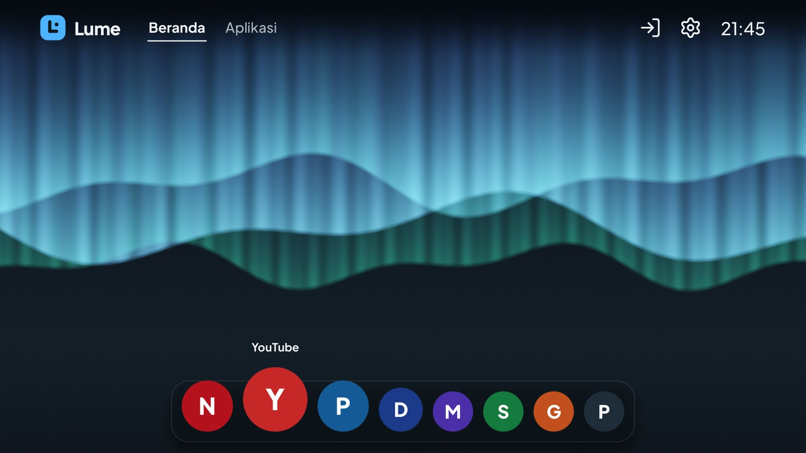
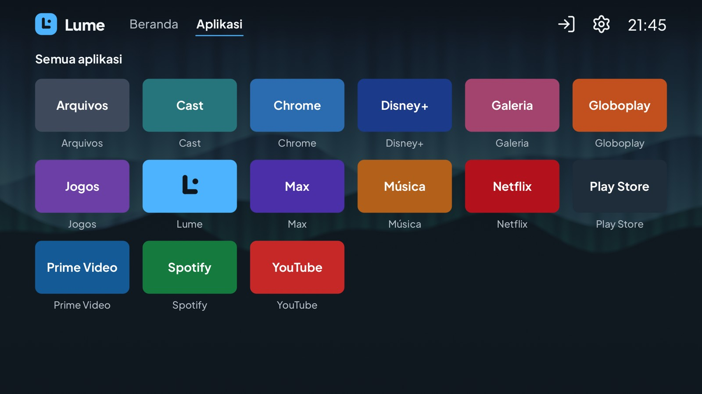
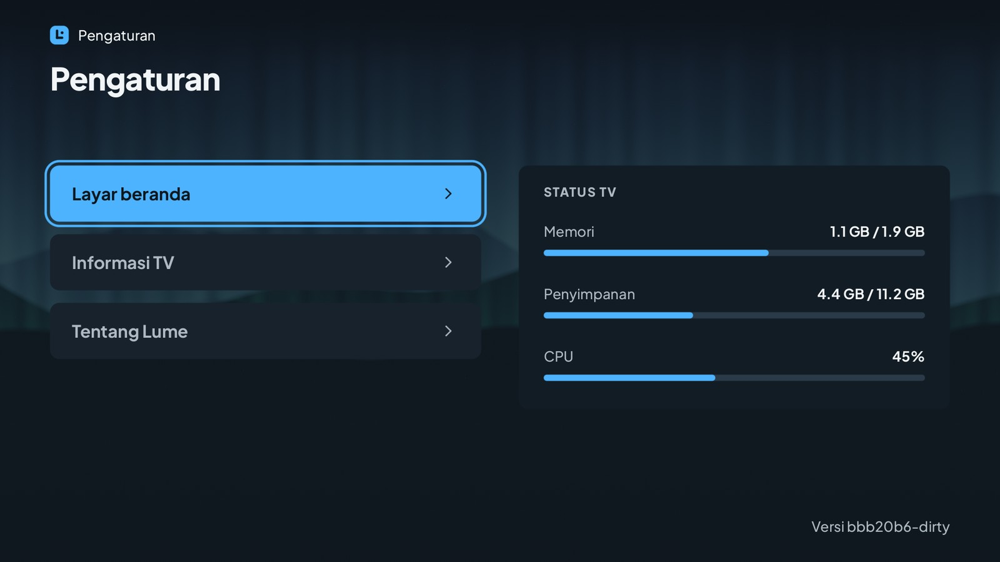
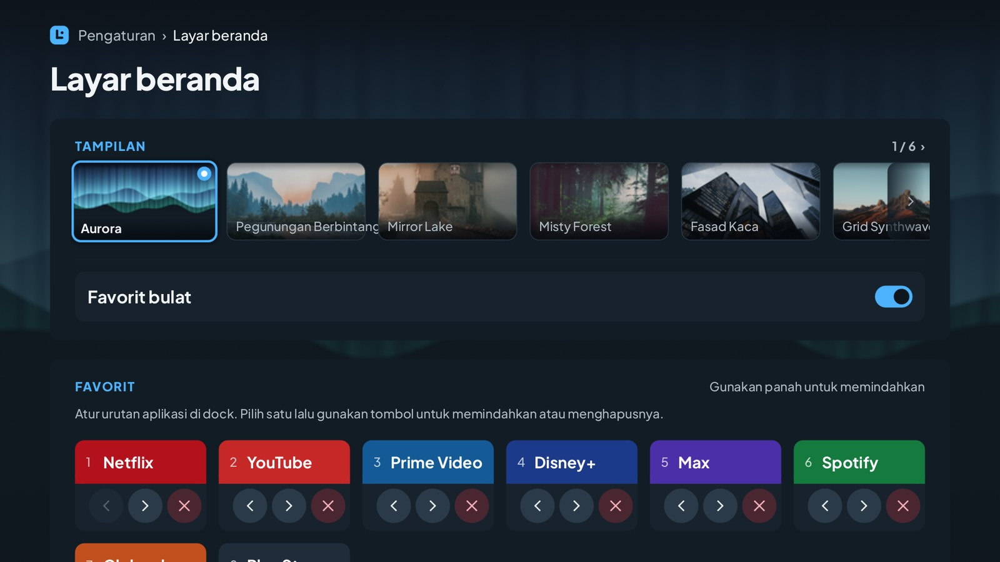

# Lume - Android TV Launcher

**Layar beranda yang cepat dan ringan untuk Android TV.** Lume menggantikan launcher bawaan TV Anda dengan launcher yang sederhana, nyaman dipakai dengan remote, dan sangat hemat memori, sehingga aplikasi streaming Anda mendapat lebih banyak memori.

[English](README.md) | [Português (Brasil)](README.pt-BR.md) | [Español](README.es.md) | Bahasa Indonesia | [Русский](README.ru.md)

> **Status:** Lume masih dalam pengembangan. Lihat [halaman **Releases**](https://github.com/douglaspands/lume-tv-launcher/releases) untuk versi terbaru dan unduhannya. Langkah-langkah di bawah menunjukkan cara memasangnya.

<p align="center">
  
  
</p>
<p align="center">
  
  
</p>

**Yang Anda dapatkan**

- Layar beranda dengan dock mengambang untuk aplikasi favorit Anda: ikon yang difokuskan membesar dan ikon di sebelahnya memberi ruang. Favorit berbentuk bulat, atau persegi jika Anda mau.
- Enam wallpaper untuk dipilih (Aurora, cahaya utara, adalah bawaannya), dibuat khusus untuk proyek ini.
- Layar "Apps" berisi semua yang terpasang di TV Anda.
- Semuanya bekerja dengan remote TV biasa (panah, OK, Kembali, Beranda).
- Inggris, Portugis (Brasil), Spanyol, Indonesia, dan Rusia, mengikuti bahasa TV Anda.
- Tanpa akses internet sama sekali: Lume tidak pernah terhubung ke jaringan dan tidak meminta izin yang berbahaya.

**Yang Anda perlukan**

- TV dengan **Android TV 9 atau lebih baru** (Android 9, 10, 11, 12, 13, 14+).
- Komputer (Windows, macOS, atau Linux) di **jaringan Wi-Fi yang sama** dengan TV.
- Sekitar 10 menit.

---

## Memasang Lume di TV Anda

Anda akan mengirim aplikasi dari komputer ke TV dengan alat kecil bernama **adb**. Ini hanya perlu dilakukan sekali.

### Yang Anda perlukan

- TV dengan **Android TV 9 atau lebih baru**, di **jaringan yang sama dengan komputer Anda** (Wi-Fi atau kabel).
- **adb** di komputer (Opsi 2 menunjukkan cara mendapatkannya).
- **Debugging USB** (atau **debugging jaringan**) aktif di opsi pengembang TV.
- **APK** Lume, dari repositori proyek: <https://github.com/douglaspands/lume-tv-launcher>.

### Apa itu adb?

**adb** (Android Debug Bridge) adalah alat baris perintah gratis dari Google. Alat ini berbicara dengan TV Anda lewat jaringan dan memasang aplikasi di sana dari komputer. Anda memerlukannya karena Lume tidak ada di toko aplikasi TV, jadi harus dikirim dari luar.

### Opsi 1: dengan asisten AI

Jika Anda memakai asisten AI yang bisa menjalankan perintah di komputer Anda (misalnya agen baris perintah), tempel prompt ini dan jawab pertanyaannya. Asisten akan meminta alamat IP TV dan konfirmasi Anda sebelum mengubah apa pun.

```text
Saya ingin memasang launcher Lume di Android TV saya memakai adb. Tolong lakukan untuk saya, langkah demi langkah, dan jawab dalam bahasa Indonesia.

1. Periksa apakah adb sudah terpasang (`adb version`). Jika belum, jelaskan cara memasang SDK Platform-Tools dari Google untuk sistem saya dan tunggu saya.
2. Unduh APK Lume terbaru dari https://github.com/douglaspands/lume-tv-launcher (lihat halaman Releases) ke sebuah folder dan beri tahu saya lokasinya.
3. Tanyakan alamat IP TV (Pengaturan > Jaringan & Internet) dan minta saya memastikan debugging USB (atau jaringan) aktif di opsi pengembang. Jangan menebak alamatnya.
4. Jalankan `adb connect <ip>:5555` lalu `adb devices`. Ingatkan saya untuk menerima pesan "Izinkan debugging USB?" di TV (Selalu izinkan), lalu jalankan kedua perintah lagi sampai TV saya tampil sebagai `device`.
5. Jalankan `adb install <lokasi APK>` dan pastikan muncul `Success`.
6. Jalankan `adb shell cmd package set-home-activity app.lume.tv/.LumeActivity` agar Lume menjadi layar beranda.

Jangan jalankan perintah lain yang mengubah TV (seperti `pm disable-user`) kecuali saya minta, dan tanyakan dulu sebelum menjalankan sesuatu yang tidak ada dalam daftar di atas.
```

### Opsi 2: manual

Lakukan sendiri enam langkah di bawah ini.

#### 1. Unduh Lume

1. Buka halaman proyek di GitHub: <https://github.com/douglaspands/lume-tv-launcher>.
2. Di *Releases*, unduh berkas **`.apk`** Lume.
3. Ingat di mana Anda menyimpannya (misalnya folder Downloads).

#### 2. Pasang adb di komputer

1. Unduh **SDK Platform-Tools** dari Google untuk sistem Anda di <https://developer.android.com/tools/releases/platform-tools>.
2. Ekstrak di folder yang mudah, misalnya `C:\platform-tools` di Windows atau `~/platform-tools` di macOS/Linux.
3. Buka terminal di folder itu:
   - **Windows:** buka folder, klik bilah alamat, ketik `cmd`, lalu tekan Enter.
   - **macOS:** buka *Terminal*, ketik `cd ~/platform-tools`, lalu tekan Enter.
   - **Linux:** buka terminal lalu ketik `cd ~/platform-tools`.

Untuk memeriksa, ketik `adb version` (di Windows) atau `./adb version` (di macOS/Linux). Nomor versi akan muncul.

> Di macOS dan Linux, tambahkan `./` di depan setiap perintah `adb` di bawah (misalnya `./adb devices`).

#### 3. Aktifkan debugging di TV

1. Di TV, buka **Setelan → Preferensi Perangkat → Tentang**.
2. Pilih **Build** (atau *Build Android TV OS*) lalu tekan OK **7 kali** sampai muncul pesan bahwa Anda sudah menjadi developer.
3. Kembali ke **Preferensi Perangkat → Opsi developer**.
4. Aktifkan **Debugging USB**, dan juga **Debugging jaringan** / **Debugging ADB melalui jaringan** jika ada.

Nama menu sedikit berbeda antar merek TV.

#### 4. Cari alamat TV

Di TV buka **Setelan → Jaringan & Internet**, pilih koneksi Anda, lalu catat **alamat IP**-nya, misalnya `192.168.1.50`.
(Beberapa TV juga menampilkannya di *Opsi developer*, di dekat sakelar debugging jaringan.)

#### 5. Hubungkan dan pasang

Di terminal yang Anda buka pada langkah 2, ketik (ganti alamatnya dengan milik Anda):

```
adb connect 192.168.1.50:5555
```

Sebuah pesan akan muncul di TV yang menanyakan *"Izinkan debugging USB?"*. Pilih **Selalu izinkan** lalu **OK**. Setelah itu jalankan perintah yang sama sekali lagi, dan pastikan TV muncul di daftar:

```
adb devices
```

Anda akan melihat TV Anda dengan kata `device` di sebelahnya. Sekarang pasang Lume (gunakan lokasi sebenarnya dari berkas yang Anda unduh):

```
adb install "C:\Users\Anda\Downloads\lume.apk"
```

Jika muncul `Success`, Lume sudah terpasang.

#### 6. Jadikan Lume layar beranda Anda

1. Tekan tombol **Beranda** di remote. Android mungkin menanyakan aplikasi beranda mana yang dipakai: pilih **Lume** lalu **Selalu**.
2. Jika tidak ada pertanyaan, atau Beranda masih membuka launcher lama, jalankan:

   ```
   adb shell cmd package set-home-activity app.lume.tv/.LumeActivity
   ```

3. Beberapa TV mengabaikannya dan tetap membuka launcher-nya sendiri. Sebagai pilihan terakhir, Anda dapat menonaktifkan launcher asli (tidak dihapus dan dapat diaktifkan lagi):

   ```
   adb shell pm disable-user --user 0 com.google.android.tvlauncher
   ```

### Kembali ke launcher asli

Hapus Lume, dan jika Anda menonaktifkan launcher asli, aktifkan lagi:

```
adb shell pm enable com.google.android.tvlauncher
adb uninstall app.lume.tv
```

### Ada yang salah?

| Masalah | Yang bisa dicoba |
|---|---|
| `adb: command not found` / `'adb' is not recognized` | Anda tidak berada di folder platform-tools. Buka terminal di dalam folder itu (langkah 2). |
| `failed to connect` / `unable to connect` | Periksa alamat TV, pastikan TV dan komputer berada di jaringan yang sama, dan debugging menyala. Coba matikan lalu nyalakan TV. |
| `device unauthorized` | Lihat layar TV dan setujui permintaannya, lalu jalankan `adb devices` lagi. |
| `INSTALL_FAILED_OLDER_SDK` | TV Anda menjalankan Android yang lebih lama dari 9. Lume tidak dapat berjalan di sana. |
| `INSTALL_FAILED_UPDATE_INCOMPATIBLE` | Build Lume yang berbeda sudah terpasang. Jalankan `adb uninstall app.lume.tv` lalu pasang lagi. |
| Beranda membuka launcher lama | Ulangi langkah 6, opsi 2 dan 3. |

---

## Untuk developer

Lume ditulis dengan Rust. Seluruh antarmukanya digambar sendiri dengan OpenGL ES 2.0 (tanpa View, WebView, AndroidX, atau Kotlin) dan melepas semua memori GPU saat aplikasi lain berada di depan.

### Struktur repositori

| Jalur | Isi |
|---|---|
| `crates/lume-css` | Parser untuk subset CSS yang dipakai tema (lihat [`docs/theme-format.md`](docs/theme-format.md)) |
| `crates/lume-strings` | Mengubah terjemahan `strings.xml` Android menjadi tabel Rust saat build |
| `crates/lume-core` | Logika yang tidak bergantung platform: layar, fokus, tema, teks dan renderer GPU, i18n, katalog, penyimpanan |
| `crates/lume-app` | Pustaka Android (`liblume.so`): NativeActivity, EGL, JNI, loop peristiwa |
| `tools/lume-desktop` | Penampil desktop dan alat tangkapan layar: menjalankan launcher tanpa TV |
| `android/` | Proyek Gradle minimal: manifest, `LumeActivity`, `LumeBridge`, resource, pengemasan |
| `themes/lume/` | Tema bawaan (MIT) |
| `docker/`, `scripts/` | Build container yang dapat diulang, pemeriksaan APK, pembuat font |
| `docs/` | Format tema, panduan terjemahan, catatan perangkat |
| `openspec/` | Spesifikasi, desain, dan daftar tugas rilis saat ini |

### Menjalankan di komputer

Anda tidak perlu TV untuk mencoba antarmukanya. Perintah ini membuka jendela dengan keyboard sebagai remote (tombol panah, **Enter** = OK, **Esc** = Kembali, **H** = Beranda):

```
cargo run -p lume-desktop
cargo run -p lume-desktop -- --locale id --size 1920x1080
```

Ini memakai kode OpenGL ES 2.0 yang sama dengan TV (renderer perangkat lunak Mesa sudah cukup). Untuk mengambil gambar sebuah layar (`home`, `apps`, `settings`, `about`, `editor`):

```
cargo run -p lume-desktop -- --screenshot home home.png
cargo run -p lume-desktop -- --size 1920x1080 --keys down,right,right --screenshot home focus.png
```

`--keys` menekan tombol terlebih dahulu (`up down left right ok back home`), `--locale` memilih bahasa, dan `--pseudo-locale` memperpanjang semua teks 40% untuk menemukan tata letak yang tidak muat. Gambar di README ini dibuat dengan `--favorites 8`, `LUME_NO_SYNTHETIC_ICONS=1` (kotak menampilkan warna dan hurufnya) dan, untuk bahasa Rusia, `LUME_FALLBACK_FONT` yang menunjuk ke font dengan huruf Sirilik (di TV, huruf itu disediakan sistem).

### Build dengan container (disarankan)

Anda hanya memerlukan runtime container. Tidak perlu Rust, NDK, atau Android SDK di komputer Anda.

Urutannya juga prioritasnya: skrip memakai runtime pertama yang ditemukan (kecuali Anda mengatur `LUME_CONTAINER`):

1. **wslc:** alat yang disertakan WSL di Windows.
2. **Docker:** dengan BuildKit (`docker buildx`).
3. **Podman:** versi 5 atau lebih baru.

Jika ketiganya tidak terpasang, skrip akan memberi tahu dan menyarankan alternatif: perbarui WSL agar mendapat `wslc`, pasang Docker atau Podman, arahkan `LUME_CONTAINER` ke runtime lain yang kompatibel dengan Docker, atau build tanpa container dengan memasang Rust, Android NDK/SDK, dan `cargo-ndk` lalu mengikuti `docker/Dockerfile` secara manual.

```
scripts/container-build.sh debug      # APK dengan arm64, armv7, dan x86_64
scripts/container-build.sh release    # APK dan AAB untuk arm64 dan armv7
```

Hasilnya ditulis ke `dist/`. Build pertama mengunduh Android SDK/NDK dan Rust sehingga cukup lama; build berikutnya memakai ulang cache. Atur `LUME_CONTAINER` untuk memaksa runtime tertentu.

Pasang di TV atau emulator Anda dengan `adb install -r dist/lume-<version>-debug.apk`.

**Menandatangani release.** Tanpa kunci, release ditandatangani dengan kunci debug dan diberi nama `...-release-debugsigned.apk`: cukup untuk Anda pasang sendiri, bukan untuk dipublikasikan. Untuk menandatangani dengan kunci Anda sendiri, atur ini sebelum menjalankan skrip (dikirim ke build sebagai secret dan tidak pernah disimpan di image):

```
export LUME_KEYSTORE=/path/to/lume.jks
export LUME_KEYSTORE_PASSWORD=...
export LUME_KEY_ALIAS=...
export LUME_KEY_PASSWORD=...
scripts/container-build.sh release    # dist/lume-<version>-release-debugsigned.apk
```

Simpan keystore di luar repositori dan buat cadangannya: kunci yang sama harus menandatangani setiap pembaruan. Versi berasal dari build, bukan dari berkas: tag rilis `v0.3.0` menghasilkan `0.3.0` (`LUME_VERSION_NAME=v0.3.0` sama saja), dan build lokal memakai hash commit singkat (`4d8438b`, dengan `-dirty` jika ada perubahan yang belum di-commit pada berkas yang dilacak; `dev` tanpa git), sehingga berkasnya bernama `dist/lume-4d8438b-release-debugsigned.apk`.

**Memeriksa APK.** `scripts/verify-apk.py dist/lume-<version>-release-debugsigned.apk` memeriksa ukuran (40 MB), ABI, perataan 16 KB pada pustaka native, bahwa setiap wallpaper tersimpan sekali di `assets/` dan bukan di dalam pustaka, serta bahwa aplikasi tidak meminta `INTERNET` maupun `QUERY_ALL_PACKAGES`.

### Build tanpa container

Anda memerlukan:

- Rust (versi dan target Android berasal dari `rust-toolchain.toml`; pasang [rustup](https://rustup.rs) dan ia akan memakainya).
- JDK 17, Android SDK platform 36, dan build-tools 36.0.0.
- Android NDK `28.2.13676358` (atur `ANDROID_NDK_HOME`).
- `cargo install cargo-ndk --version 4.1.2 --locked`

Lalu:

```
cd android
./gradlew assembleDebug      # atau assembleRelease
```

Gradle memanggil `cargo ndk` untuk Anda dan meratakan pustaka native ke halaman 16 KB.

### Menjalankan pengujian

```
cargo fmt --all --check
cargo clippy --workspace --all-targets -- -D warnings
cargo test --workspace
```

Pengujian grafis memerlukan EGL yang berfungsi (Mesa di Linux); pengujian dilewati jika tidak ada.

### Rilis

Mengirim tag seperti `v0.1.0` (atau `v0.1.0-rc1` untuk pra-rilis) menjalankan `.github/workflows/release.yml`: workflow itu membangun APK dan AAB bertanda tangan dengan Dockerfile yang sama, menjalankan pemeriksaan di atas, dan melampirkan APK ke rilis GitHub. Ia memerlukan secret repositori berikut: `LUME_KEYSTORE_BASE64` (keystore dalam base64), `LUME_KEYSTORE_PASSWORD`, `LUME_KEY_ALIAS`, dan `LUME_KEY_PASSWORD`.

### Terjemahan

Terjemahan adalah berkas `strings.xml` standar Android di `android/app/src/main/res/values-<bahasa>/`. Lihat [`docs/translations.md`](docs/translations.md).

### Wallpaper

Lume menggambar salah satu dari enam wallpaper di belakang setiap layar, semuanya gambar 3840x2160 (Unsplash License) dan diperkecil ke Full HD saat build. Cara pemrosesannya, cara menambah atau mengganti satu wallpaper, dan tempat asal serta lisensinya dicatat: [`docs/wallpaper.md`](docs/wallpaper.md).

### Kontribusi, lisensi, dan merek dagang

- Kode dilisensikan di bawah **GPL-3.0-or-later** ([`LICENSE`](LICENSE)); tema di bawah **MIT** ([`themes/LICENSE`](themes/LICENSE)).
- Nama dan logo "lume" tidak dilisensikan: lihat [`TRADEMARKS.md`](TRADEMARKS.md).
- Kontribusi memerlukan CLA yang ditandatangani: lihat [`CONTRIBUTING.md`](CONTRIBUTING.md) dan [`CLA.md`](CLA.md).
