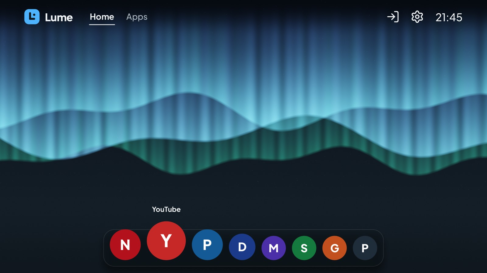
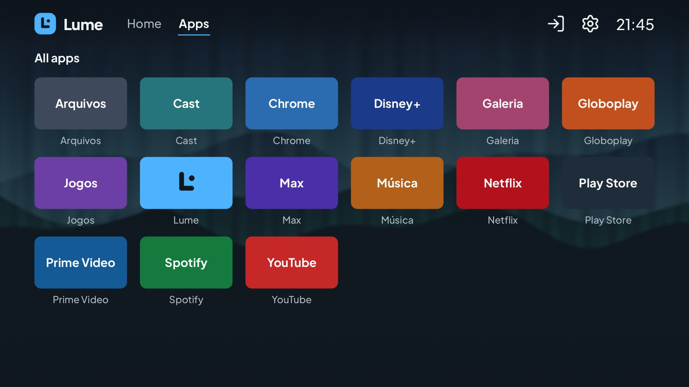
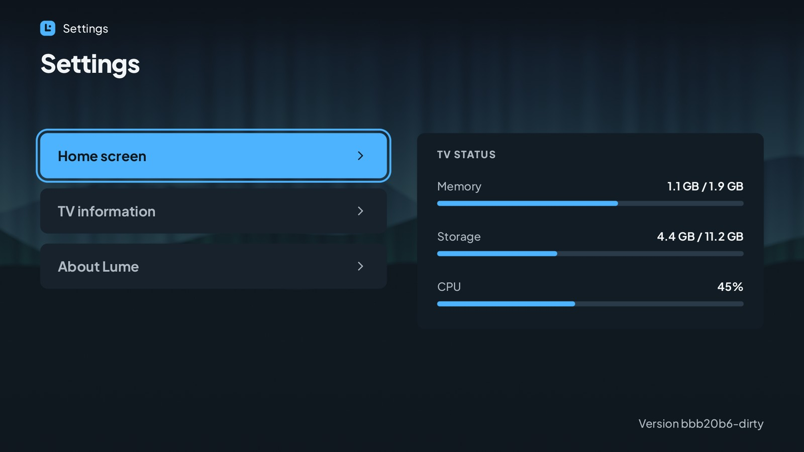
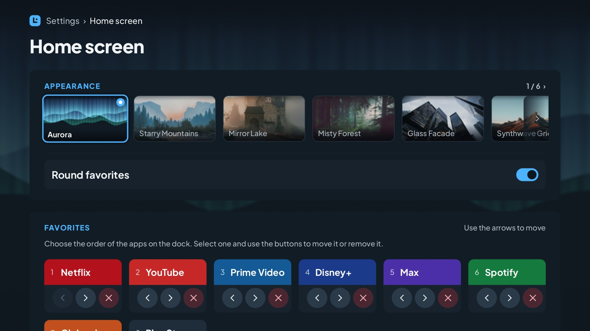

# Lume - Android TV Launcher

**A fast, lightweight home screen for Android TV.** Lume replaces the launcher that came with your TV with a clean, remote-friendly one that uses very little memory, so your streaming apps get more of it.

English | [Português (Brasil)](README.pt-BR.md) | [Español](README.es.md) | [Bahasa Indonesia](README.id.md) | [Русский](README.ru.md)

> **Status:** Lume is in development. Check the [**Releases** page](https://github.com/douglaspands/lume-tv-launcher/releases) for the newest version and its download. The steps below show how to install it.

<p align="center">
  
  
</p>
<p align="center">
  
  
</p>

**What you get**

- A home screen with a floating dock for your favorite apps: the icon under the focus grows, and the neighbors make room. The favorites are round, or square if you prefer.
- Six wallpapers to choose from (the northern-lights Aurora is the default), made for this project.
- An "Apps" screen with everything installed on your TV.
- Everything works with the normal TV remote (arrows, OK, Back, Home).
- English, Portuguese (Brazil), Spanish, Indonesian and Russian, following your TV's language.
- No internet access at all: Lume never connects to the network and asks for no dangerous permissions.

**What you need**

- A TV running **Android TV 9 or newer** (Android 9, 10, 11, 12, 13, 14+).
- A computer (Windows, macOS or Linux) on the **same Wi-Fi or network** as the TV.
- About 10 minutes.

---

## Install Lume on your TV

You will send the app to the TV from your computer with a small tool called **adb**. You only do this once.

### What you need

- A TV with **Android TV 9 or newer**, on the **same network as your computer** (Wi-Fi or cable).
- **adb** on your computer (Option 2 shows how to get it).
- **USB debugging** (or **Network debugging**) turned on in the TV's developer options.
- The Lume **APK**, from the project's repository: <https://github.com/douglaspands/lume-tv-launcher>.

### What is adb?

**adb** (Android Debug Bridge) is a free command-line tool from Google. It talks to your TV over the network and installs apps on it from your computer. You need it because Lume is not in the TV's app store, so it has to be sent from outside.

### Option 1: with an AI assistant

If you use an AI assistant that can run commands on your computer (for example a command-line agent), paste this prompt and answer its questions. It asks for your TV's IP address and for your confirmation before changing anything.

```text
I want to install the Lume launcher on my Android TV using adb. Please do it for me, step by step, and answer in English.

1. Check that adb is installed (`adb version`). If it is not, tell me how to install Google's SDK Platform-Tools for my system and wait for me.
2. Download the latest Lume APK from https://github.com/douglaspands/lume-tv-launcher (see the Releases page) to a folder and tell me the path.
3. Ask me for the TV's IP address (Settings > Network & Internet) and ask me to confirm that USB debugging (or network debugging) is on in the developer options. Do not guess the address.
4. Run `adb connect <ip>:5555` and then `adb devices`. Remind me to accept the "Allow USB debugging?" prompt on the TV (Always allow), then run both commands again until my TV is listed as `device`.
5. Run `adb install <path to the APK>` and confirm it printed `Success`.
6. Run `adb shell cmd package set-home-activity app.lume.tv/.LumeActivity` to make Lume the home screen.

Do not run any other command that changes the TV (such as `pm disable-user`) unless I ask, and ask me before running anything not listed above.
```

### Option 2: manually

Do the six steps below yourself.

#### 1. Download Lume

1. Open the project page on GitHub: <https://github.com/douglaspands/lume-tv-launcher>.
2. Under *Releases*, download the Lume **`.apk`** file.
3. Remember where you saved it (for example, your Downloads folder).

#### 2. Get adb on your computer

1. Download Google's **SDK Platform-Tools** for your system from <https://developer.android.com/tools/releases/platform-tools>.
2. Unzip it somewhere easy, for example `C:\platform-tools` on Windows or `~/platform-tools` on macOS/Linux.
3. Open a terminal in that folder:
   - **Windows:** open the folder, click the address bar, type `cmd` and press Enter.
   - **macOS:** open *Terminal*, type `cd ~/platform-tools` and press Enter.
   - **Linux:** open a terminal and `cd ~/platform-tools`.

To check that it works, type `adb version` (on Windows) or `./adb version` (on macOS/Linux). You should see a version number.

> On macOS and Linux put `./` in front of every `adb` command below (for example `./adb devices`).

#### 3. Turn on debugging on the TV

1. On the TV, open **Settings → Device Preferences → About**.
2. Select **Build** (or *Android TV OS build*) and press OK **7 times** until it says you are a developer.
3. Go back to **Device Preferences → Developer options**.
4. Turn on **USB debugging**, and also **Network debugging** / **ADB debugging over network** if you see it.

The exact menu names change a little between TV brands.

#### 4. Find the TV's address

On the TV open **Settings → Network & Internet**, select your connection and write down the **IP address**, something like `192.168.1.50`.
(Some TVs also show it under *Developer options* next to the network debugging switch.)

#### 5. Connect and install

In the terminal you opened in step 2, type (replace the address with yours):

```
adb connect 192.168.1.50:5555
```

A message will pop up on the TV asking *"Allow USB debugging?"*. Choose **Always allow** and **OK**. Then run the same command again, and check that the TV is listed:

```
adb devices
```

You should see your TV with the word `device` next to it. Now install Lume (use the real path of the file you downloaded):

```
adb install "C:\Users\You\Downloads\lume.apk"
```

When you see `Success`, Lume is installed.

#### 6. Make Lume your home screen

1. Press the **Home** button on your remote. Android may ask which home app to use: choose **Lume** and **Always**.
2. If nothing was asked, or Home still opens the old launcher, run:

   ```
   adb shell cmd package set-home-activity app.lume.tv/.LumeActivity
   ```

3. Some TVs ignore that and keep opening their own launcher. As a last resort you can turn the original launcher off (this does not delete it and you can turn it back on):

   ```
   adb shell pm disable-user --user 0 com.google.android.tvlauncher
   ```

### Go back to the original launcher

Remove Lume, and if you turned the original launcher off, turn it on again:

```
adb shell pm enable com.google.android.tvlauncher
adb uninstall app.lume.tv
```

### Something went wrong?

| Problem | What to try |
|---|---|
| `adb: command not found` / `'adb' is not recognized` | You are not in the platform-tools folder. Open the terminal inside it (step 2). |
| `failed to connect` / `unable to connect` | Check the TV address, that the TV and the computer are on the same network, and that debugging is on. Try turning the TV off and on. |
| `device unauthorized` | Look at the TV screen and accept the prompt, then run `adb devices` again. |
| `INSTALL_FAILED_OLDER_SDK` | Your TV runs Android older than 9. Lume cannot run on it. |
| `INSTALL_FAILED_UPDATE_INCOMPATIBLE` | A different build of Lume is installed. Run `adb uninstall app.lume.tv` and install again. |
| Home opens the old launcher | Repeat step 6, options 2 and 3. |

---

## For developers

Lume is written in Rust. It draws its whole interface itself with OpenGL ES 2.0 (no Views, no WebView, no AndroidX, no Kotlin) and releases all GPU memory while another app is in front.

### Repository layout

| Path | What is inside |
|---|---|
| `crates/lume-css` | Parser for the CSS subset used by themes (see [`docs/theme-format.md`](docs/theme-format.md)) |
| `crates/lume-strings` | Turns Android `strings.xml` translations into Rust tables at build time |
| `crates/lume-core` | Platform-independent logic: launcher screens, focus, theme, text and GPU renderer, i18n, catalog, persistence |
| `crates/lume-app` | The Android library (`liblume.so`): NativeActivity, EGL, JNI, event loop |
| `tools/lume-desktop` | Desktop viewer and screenshot tool: runs the launcher without a TV |
| `android/` | Minimal Gradle project: manifest, `LumeActivity`, `LumeBridge`, resources, packaging |
| `themes/lume/` | The default theme (MIT) |
| `docker/`, `scripts/` | Reproducible container build, APK checks, font and test-font generators |
| `docs/` | Theme format, translation guide, device notes |
| `openspec/` | Specs, design and task list of the current release |

### Run it on your computer

You do not need a TV to try the interface. This opens a window where the keyboard is the remote (arrow keys, **Enter** = OK, **Esc** = Back, **H** = Home):

```
cargo run -p lume-desktop
cargo run -p lume-desktop -- --locale en --size 1920x1080
```

It renders with the same OpenGL ES 2.0 code as the TV (Mesa's software renderer is enough). To take pictures of a screen instead (`home`, `apps`, `settings`, `about`, `editor`):

```
cargo run -p lume-desktop -- --screenshot home home.png
cargo run -p lume-desktop -- --size 1920x1080 --keys down,right,right --screenshot home focus.png
```

`--keys` presses keys first (`up down left right ok back home`), `--locale` picks the language and `--pseudo-locale` stretches every text by 40% to find layouts that do not fit. The pictures of this README were made with `--favorites 8`, `LUME_NO_SYNTHETIC_ICONS=1` (tiles show their color and letter) and, for Russian, `LUME_FALLBACK_FONT` pointing to a font with Cyrillic letters (on the TV the system gives them).

### Build with a container (recommended)

You only need a container runtime. No Rust, NDK or Android SDK on your machine.

The order is also the priority: the script uses the first runtime it finds (unless you set `LUME_CONTAINER`):

1. **wslc:** the tool that ships with WSL on Windows.
2. **Docker:** with BuildKit (`docker buildx`).
3. **Podman:** version 5 or newer.

If none of the three is installed, the script says so and suggests alternatives: update WSL to get `wslc`, install Docker or Podman, point `LUME_CONTAINER` at another Docker-compatible runtime, or build without containers by installing Rust, the Android NDK/SDK and `cargo-ndk` and following `docker/Dockerfile` by hand.

```
scripts/container-build.sh debug      # APK with arm64, armv7 and x86_64
scripts/container-build.sh release    # APK and AAB for arm64 and armv7
```

The result is written to `dist/`. The first build downloads the Android SDK/NDK and Rust and takes a while; later builds reuse the cache. Set `LUME_CONTAINER` to force a runtime.

Install it on your TV or emulator with `adb install -r dist/lume-<version>-debug.apk`.

**Signing a release.** Without a key, the release is signed with the debug key and named `...-release-debugsigned.apk`: fine to install yourself, not to publish. To sign with your own key, set these before running the script (they are passed to the build as secrets and never stored in the image):

```
export LUME_KEYSTORE=/path/to/lume.jks
export LUME_KEYSTORE_PASSWORD=...
export LUME_KEY_ALIAS=...
export LUME_KEY_PASSWORD=...
scripts/container-build.sh release    # dist/lume-<version>-release-debugsigned.apk
```

Keep the keystore outside the repository and back it up: the same key must sign every update. The version comes from the build, not from a file: a release tag `v0.3.0` gives `0.3.0` (`LUME_VERSION_NAME=v0.3.0` does the same), and a local build uses the short git commit (`4d8438b`, with `-dirty` for uncommitted changes to tracked files; `dev` without git), so the file is named `dist/lume-4d8438b-release-debugsigned.apk`.

**Checking an APK.** `scripts/verify-apk.py dist/lume-<version>-release-debugsigned.apk` checks the size (40 MB), the ABIs, the 16 KB alignment of the native libraries, that each wallpaper is stored once in `assets/` and not inside a library, and that the app asks for neither `INTERNET` nor `QUERY_ALL_PACKAGES`.

### Build without a container

You need:

- Rust (the version and Android targets come from `rust-toolchain.toml`; install [rustup](https://rustup.rs) and it picks them up).
- JDK 17, Android SDK platform 36 and build-tools 36.0.0.
- Android NDK `28.2.13676358` (set `ANDROID_NDK_HOME`).
- `cargo install cargo-ndk --version 4.1.2 --locked`

Then:

```
cd android
./gradlew assembleDebug      # or assembleRelease
```

Gradle calls `cargo ndk` for you and aligns the native libraries to 16 KB pages.

### Run the tests

```
cargo fmt --all --check
cargo clippy --workspace --all-targets -- -D warnings
cargo test --workspace
```

The graphics tests need a working EGL (Mesa on Linux); they are skipped when none is available.

### Releases

Pushing a tag such as `v0.1.0` (or `v0.1.0-rc1` for a pre-release) runs `.github/workflows/release.yml`: it builds the signed APK and AAB with the same Dockerfile, runs the checks above and attaches the APK to a GitHub release. It needs these repository secrets: `LUME_KEYSTORE_BASE64` (the keystore, base64-encoded), `LUME_KEYSTORE_PASSWORD`, `LUME_KEY_ALIAS` and `LUME_KEY_PASSWORD`.

### Translations

Translations are standard Android `strings.xml` files in `android/app/src/main/res/values-<locale>/`. See [`docs/translations.md`](docs/translations.md).

### Wallpaper

Lume draws one of six wallpapers behind every screen, 3840x2160 images (Unsplash License), reduced to Full HD at build time. How they are processed, how to add or replace one and where their origin and license are recorded: [`docs/wallpaper.md`](docs/wallpaper.md).

### Contributing, license and trademarks

- Code is licensed under **GPL-3.0-or-later** ([`LICENSE`](LICENSE)); themes under **MIT** ([`themes/LICENSE`](themes/LICENSE)).
- The name and logo "lume" are not licensed: see [`TRADEMARKS.md`](TRADEMARKS.md).
- Contributions need a signed CLA: see [`CONTRIBUTING.md`](CONTRIBUTING.md) and [`CLA.md`](CLA.md).
