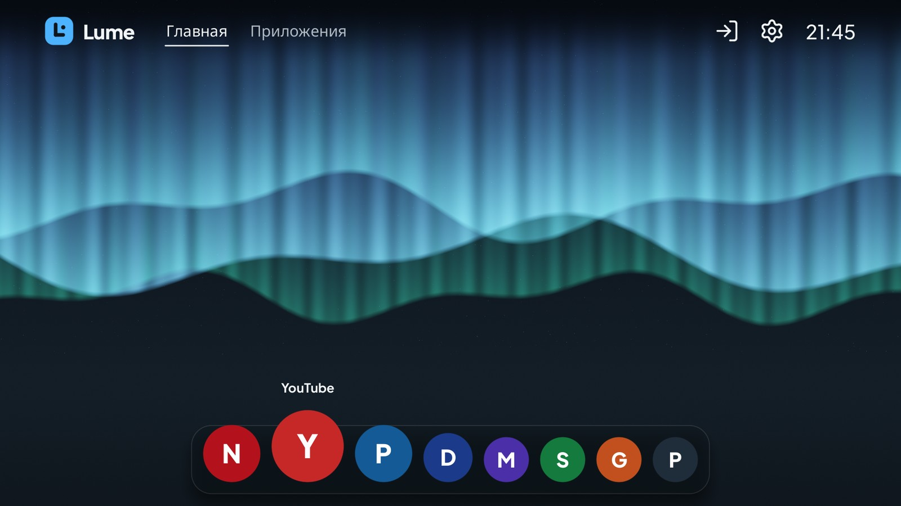
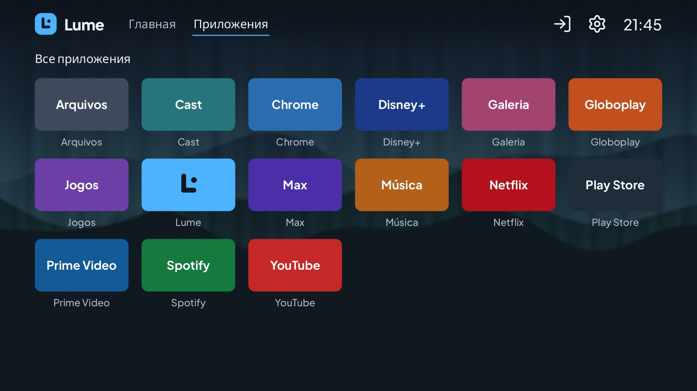
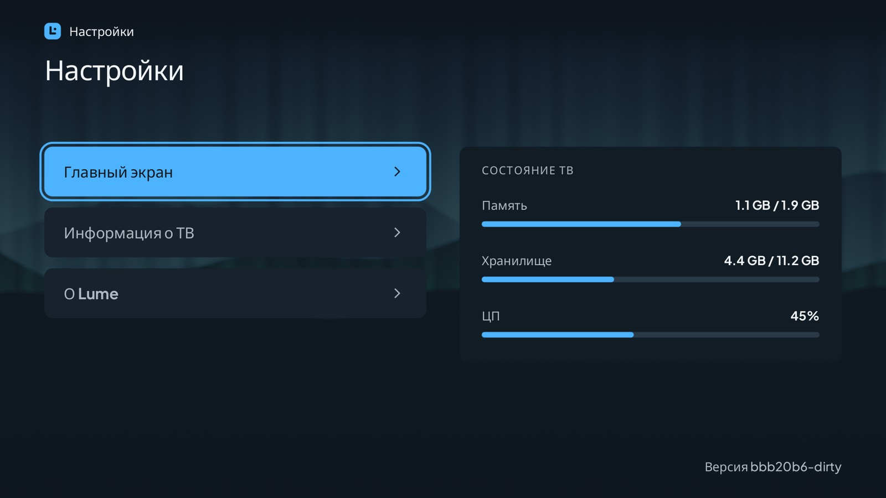
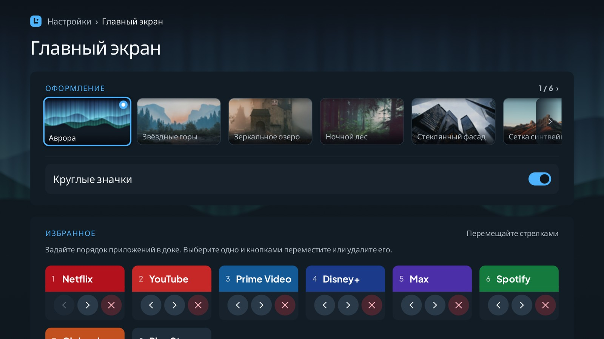

# Lume - Android TV Launcher

**Быстрый и лёгкий главный экран для Android TV.** Lume заменяет штатный лаунчер вашего телевизора простым лаунчером, удобным с пульта и потребляющим очень мало памяти, так что приложениям для стриминга достаётся больше.

[English](README.md) | [Português (Brasil)](README.pt-BR.md) | [Español](README.es.md) | [Bahasa Indonesia](README.id.md) | Русский

> **Статус:** Lume находится в разработке. Самую новую версию и её загрузку смотрите на [странице **Releases**](https://github.com/douglaspands/lume-tv-launcher/releases). Ниже показано, как её установить.

<p align="center">
  
  
</p>
<p align="center">
  
  
</p>

**Что вы получаете**

- Главный экран с плавающим доком для любимых приложений: значок в фокусе увеличивается, а соседние уступают ему место. Значки избранного круглые, а при желании — квадратные.
- Шесть обоев на выбор (по умолчанию — северное сияние Aurora), созданные специально для проекта.
- Экран «Apps» со всем, что установлено на телевизоре.
- Всё работает с обычным пультом (стрелки, OK, Назад, Домой).
- Английский, португальский (Бразилия), испанский, индонезийский и русский — по языку телевизора.
- Никакого доступа в интернет: Lume не подключается к сети и не запрашивает опасных разрешений.

**Что вам понадобится**

- Телевизор с **Android TV 9 или новее** (Android 9, 10, 11, 12, 13, 14+).
- Компьютер (Windows, macOS или Linux) в **той же сети Wi-Fi**, что и телевизор.
- Около 10 минут.

---

## Установка Lume на телевизор

Вы отправите приложение с компьютера на телевизор с помощью небольшой программы **adb**. Это нужно сделать один раз.

### Что понадобится

- Телевизор с **Android TV 9 или новее** в **той же сети, что и компьютер** (Wi-Fi или кабель).
- **adb** на компьютере (вариант 2 показывает, как его получить).
- Включённая **отладка по USB** (или **отладка по сети**) в параметрах разработчика телевизора.
- **APK** Lume из репозитория проекта: <https://github.com/douglaspands/lume-tv-launcher>.

### Что такое adb?

**adb** (Android Debug Bridge) — бесплатная программа командной строки от Google. Она общается с телевизором по сети и устанавливает на него приложения с компьютера. Она нужна, потому что Lume нет в магазине приложений телевизора, поэтому его нужно отправить снаружи.

### Вариант 1: с помощью ИИ-ассистента

Если вы пользуетесь ИИ-ассистентом, который умеет запускать команды на вашем компьютере (например, агентом командной строки), вставьте этот промпт и отвечайте на его вопросы. Перед любыми изменениями он спросит IP-адрес телевизора и ваше подтверждение.

```text
Я хочу установить лаунчер Lume на свой Android TV с помощью adb. Сделай это за меня, шаг за шагом, и отвечай по-русски.

1. Проверь, что adb установлен (`adb version`). Если нет, объясни, как установить Google SDK Platform-Tools для моей системы, и подожди меня.
2. Скачай последний APK Lume с https://github.com/douglaspands/lume-tv-launcher (см. страницу Releases) в папку и сообщи мне путь.
3. Спроси IP-адрес телевизора (Настройки > Сеть и интернет) и попроси подтвердить, что отладка по USB (или по сети) включена в параметрах разработчика. Не угадывай адрес.
4. Выполни `adb connect <ip>:5555`, затем `adb devices`. Напомни мне принять запрос «Разрешить отладку по USB?» на телевизоре (Всегда разрешать) и выполни обе команды снова, пока телевизор не появится как `device`.
5. Выполни `adb install <путь к APK>` и убедись, что вывелось `Success`.
6. Выполни `adb shell cmd package set-home-activity app.lume.tv/.LumeActivity`, чтобы сделать Lume главным экраном.

Не выполняй других команд, меняющих телевизор (например, `pm disable-user`), пока я не попрошу, и спрашивай меня перед запуском всего, чего нет в списке выше.
```

### Вариант 2: вручную

Выполните шесть шагов ниже самостоятельно.

#### 1. Скачайте Lume

1. Откройте страницу проекта на GitHub: <https://github.com/douglaspands/lume-tv-launcher>.
2. В разделе *Releases* скачайте файл Lume с расширением **`.apk`**.
3. Запомните, куда вы его сохранили (например, в папку «Загрузки»).

#### 2. Установите adb на компьютер

1. Скачайте **SDK Platform-Tools** от Google для своей системы: <https://developer.android.com/tools/releases/platform-tools>.
2. Распакуйте в удобное место, например `C:\platform-tools` в Windows или `~/platform-tools` в macOS/Linux.
3. Откройте терминал в этой папке:
   - **Windows:** откройте папку, щёлкните адресную строку, введите `cmd` и нажмите Enter.
   - **macOS:** откройте *Терминал*, введите `cd ~/platform-tools` и нажмите Enter.
   - **Linux:** откройте терминал и введите `cd ~/platform-tools`.

Чтобы проверить, введите `adb version` (в Windows) или `./adb version` (в macOS/Linux). Должен появиться номер версии.

> В macOS и Linux ставьте `./` перед каждой командой `adb` ниже (например, `./adb devices`).

#### 3. Включите отладку на телевизоре

1. На телевизоре откройте **Настройки → Параметры устройства → О системе**.
2. Выберите **Сборка** (или *Сборка Android TV OS*) и нажмите OK **7 раз**, пока не появится сообщение, что вы стали разработчиком.
3. Вернитесь в **Параметры устройства → Для разработчиков**.
4. Включите **Отладку по USB**, а также **Отладку по сети** / **Отладку ADB по сети**, если она есть.

Названия пунктов меню немного отличаются у разных производителей.

#### 4. Узнайте адрес телевизора

На телевизоре откройте **Настройки → Сеть и Интернет**, выберите своё подключение и запишите **IP-адрес**, например `192.168.1.50`.
(Некоторые телевизоры также показывают его в разделе *Для разработчиков* рядом с переключателем отладки по сети.)

#### 5. Подключитесь и установите

В терминале, который вы открыли на шаге 2, введите (замените адрес на свой):

```
adb connect 192.168.1.50:5555
```

На телевизоре появится сообщение *«Разрешить отладку по USB?»*. Выберите **Всегда разрешать** и **OK**. Затем выполните ту же команду ещё раз и убедитесь, что телевизор есть в списке:

```
adb devices
```

Вы должны увидеть свой телевизор со словом `device` рядом. Теперь установите Lume (укажите настоящий путь к скачанному файлу):

```
adb install "C:\Users\User\Downloads\lume.apk"
```

Когда появится `Success`, Lume установлен.

#### 6. Сделайте Lume главным экраном

1. Нажмите кнопку **Домой** на пульте. Android может спросить, какое приложение использовать как главный экран: выберите **Lume** и **Всегда**.
2. Если ничего не спросили или «Домой» по-прежнему открывает старый лаунчер, выполните:

   ```
   adb shell cmd package set-home-activity app.lume.tv/.LumeActivity
   ```

3. Некоторые телевизоры игнорируют это и продолжают открывать свой лаунчер. В крайнем случае можно отключить штатный лаунчер (он не удаляется, и его можно включить снова):

   ```
   adb shell pm disable-user --user 0 com.google.android.tvlauncher
   ```

### Вернуться к штатному лаунчеру

Удалите Lume и, если вы отключали штатный лаунчер, включите его снова:

```
adb shell pm enable com.google.android.tvlauncher
adb uninstall app.lume.tv
```

### Что-то пошло не так?

| Проблема | Что попробовать |
|---|---|
| `adb: command not found` / `'adb' is not recognized` | Вы не в папке platform-tools. Откройте терминал внутри неё (шаг 2). |
| `failed to connect` / `unable to connect` | Проверьте адрес телевизора, что телевизор и компьютер в одной сети и что отладка включена. Попробуйте выключить и включить телевизор. |
| `device unauthorized` | Посмотрите на экран телевизора и подтвердите запрос, затем снова выполните `adb devices`. |
| `INSTALL_FAILED_OLDER_SDK` | На вашем телевизоре Android старше 9. Lume на нём работать не может. |
| `INSTALL_FAILED_UPDATE_INCOMPATIBLE` | Установлена другая сборка Lume. Выполните `adb uninstall app.lume.tv` и установите снова. |
| «Домой» открывает старый лаунчер | Повторите шаг 6, варианты 2 и 3. |

---

## Для разработчиков

Lume написан на Rust. Весь интерфейс он рисует сам через OpenGL ES 2.0 (без Views, WebView, AndroidX и Kotlin) и освобождает всю память GPU, пока на переднем плане другое приложение.

### Структура репозитория

| Путь | Что внутри |
|---|---|
| `crates/lume-css` | Разборщик подмножества CSS, которое используют темы (см. [`docs/theme-format.md`](docs/theme-format.md)) |
| `crates/lume-strings` | Превращает переводы Android `strings.xml` в таблицы Rust при сборке |
| `crates/lume-core` | Платформонезависимая логика: экраны, фокус, тема, текст и GPU-рендерер, i18n, каталог, хранение |
| `crates/lume-app` | Библиотека Android (`liblume.so`): NativeActivity, EGL, JNI, цикл событий |
| `tools/lume-desktop` | Настольный просмотрщик и инструмент снимков экрана: запускает лаунчер без телевизора |
| `android/` | Минимальный проект Gradle: манифест, `LumeActivity`, `LumeBridge`, ресурсы, упаковка |
| `themes/lume/` | Тема по умолчанию (MIT) |
| `docker/`, `scripts/` | Воспроизводимая сборка в контейнере, проверки APK, генераторы шрифтов |
| `docs/` | Формат темы, руководство по переводу, заметки об устройствах |
| `openspec/` | Спецификации, дизайн и список задач текущего выпуска |

### Запуск на компьютере

Чтобы попробовать интерфейс, телевизор не нужен. Эта команда открывает окно, в котором клавиатура служит пультом (стрелки, **Enter** = OK, **Esc** = Назад, **H** = Домой):

```
cargo run -p lume-desktop
cargo run -p lume-desktop -- --locale ru --size 1920x1080
```

Используется тот же код OpenGL ES 2.0, что и на телевизоре (достаточно программного рендерера Mesa). Чтобы вместо этого получить снимки экрана (`home`, `apps`, `settings`, `about`, `editor`):

```
cargo run -p lume-desktop -- --screenshot home home.png
cargo run -p lume-desktop -- --size 1920x1080 --keys down,right,right --screenshot home focus.png
```

`--keys` сначала нажимает клавиши (`up down left right ok back home`), `--locale` выбирает язык, а `--pseudo-locale` растягивает все тексты на 40 %, чтобы найти макеты, в которые они не помещаются. Снимки в этом README сделаны с `--favorites 8`, `LUME_NO_SYNTHETIC_ICONS=1` (плитки показывают свой цвет и букву) и, для русского, `LUME_FALLBACK_FONT` с путём к шрифту с кириллицей (на телевизоре её даёт система).

### Сборка в контейнере (рекомендуется)

Нужна только среда запуска контейнеров. Rust, NDK и Android SDK на вашем компьютере не требуются.

Порядок одновременно и приоритет: скрипт берёт первую найденную среду (если вы не задали `LUME_CONTAINER`):

1. **wslc:** инструмент, который входит в WSL на Windows.
2. **Docker:** с BuildKit (`docker buildx`).
3. **Podman:** версии 5 или новее.

Если не установлена ни одна из трёх, скрипт сообщит об этом и предложит варианты: обновить WSL, чтобы получить `wslc`, установить Docker или Podman, указать в `LUME_CONTAINER` другую среду, совместимую с Docker, или собрать без контейнеров, установив Rust, Android NDK/SDK и `cargo-ndk` и выполнив шаги из `docker/Dockerfile` вручную.

```
scripts/container-build.sh debug      # APK для arm64, armv7 и x86_64
scripts/container-build.sh release    # APK и AAB для arm64 и armv7
```

Результат записывается в `dist/`. Первая сборка скачивает Android SDK/NDK и Rust и занимает время; следующие используют кэш. Задайте `LUME_CONTAINER`, чтобы принудительно выбрать среду.

Установите его на телевизор или эмулятор командой `adb install -r dist/lume-<version>-debug.apk`.

**Подпись релиза.** Без ключа релиз подписывается ключом отладки и называется `...-release-debugsigned.apk`: его можно ставить себе, но не публиковать. Чтобы подписать собственным ключом, задайте следующее перед запуском скрипта (значения передаются сборке как секреты и никогда не попадают в образ):

```
export LUME_KEYSTORE=/path/to/lume.jks
export LUME_KEYSTORE_PASSWORD=...
export LUME_KEY_ALIAS=...
export LUME_KEY_PASSWORD=...
scripts/container-build.sh release    # dist/lume-<version>-release-debugsigned.apk
```

Храните keystore вне репозитория и делайте его резервную копию: каждое обновление должно быть подписано тем же ключом. Версия берётся из сборки, а не из файла: тег релиза `v0.3.0` даёт `0.3.0` (`LUME_VERSION_NAME=v0.3.0` делает то же самое), а локальная сборка использует короткий хеш коммита (`4d8438b`, с `-dirty`, если в отслеживаемых файлах есть незафиксированные изменения; `dev` без git), поэтому файл называется `dist/lume-4d8438b-release-debugsigned.apk`.

**Проверка APK.** `scripts/verify-apk.py dist/lume-<version>-release-debugsigned.apk` проверяет размер (40 МБ), ABI, выравнивание нативных библиотек по 16 КБ, что каждые обои лежат в `assets/` один раз, а не внутри библиотеки, и что приложение не запрашивает ни `INTERNET`, ни `QUERY_ALL_PACKAGES`.

### Сборка без контейнера

Вам понадобятся:

- Rust (версия и цели Android берутся из `rust-toolchain.toml`; установите [rustup](https://rustup.rs), и он их подхватит).
- JDK 17, Android SDK platform 36 и build-tools 36.0.0.
- Android NDK `28.2.13676358` (задайте `ANDROID_NDK_HOME`).
- `cargo install cargo-ndk --version 4.1.2 --locked`

Затем:

```
cd android
./gradlew assembleDebug      # или assembleRelease
```

Gradle сам вызывает `cargo ndk` и выравнивает нативные библиотеки по страницам в 16 КБ.

### Запуск тестов

```
cargo fmt --all --check
cargo clippy --workspace --all-targets -- -D warnings
cargo test --workspace
```

Графическим тестам нужен рабочий EGL (Mesa в Linux); если его нет, тесты пропускаются.

### Релизы

Отправка тега вроде `v0.1.0` (или `v0.1.0-rc1` для предварительного выпуска) запускает `.github/workflows/release.yml`: он собирает подписанные APK и AAB тем же Dockerfile, выполняет проверки выше и прикрепляет APK к релизу на GitHub. Ему нужны такие секреты репозитория: `LUME_KEYSTORE_BASE64` (keystore в base64), `LUME_KEYSTORE_PASSWORD`, `LUME_KEY_ALIAS` и `LUME_KEY_PASSWORD`.

### Переводы

Переводы — это обычные файлы Android `strings.xml` в `android/app/src/main/res/values-<язык>/`. См. [`docs/translations.md`](docs/translations.md).

### Обои

Lume рисует за всеми экранами одни из шести обоев, все они — изображения 3840x2160 (Unsplash License) и уменьшаются до Full HD при сборке. Как их обрабатывают, как добавить или заменить одни и где записаны их происхождение и лицензия: [`docs/wallpaper.md`](docs/wallpaper.md).

### Участие в проекте, лицензия и товарный знак

- Код распространяется по лицензии **GPL-3.0-or-later** ([`LICENSE`](LICENSE)); темы — по **MIT** ([`themes/LICENSE`](themes/LICENSE)).
- Название и логотип «lume» не лицензируются: см. [`TRADEMARKS.md`](TRADEMARKS.md).
- Для участия нужно подписать CLA: см. [`CONTRIBUTING.md`](CONTRIBUTING.md) и [`CLA.md`](CLA.md).
