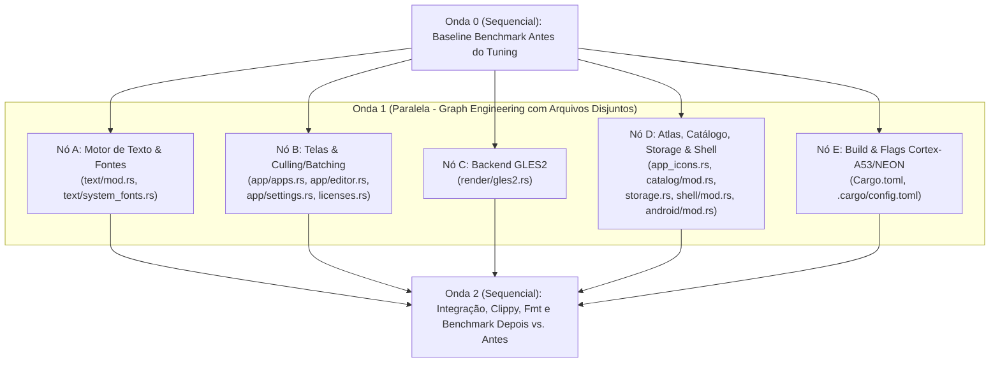

# Design

## Context

Ver `proposal.md` (Why). O Lume foi projetado para rodar em TVs Android TV de entrada (4× ARM Cortex-A53 32 bits em `armeabi-v7a`, GPUs Mali-470 MP e Mali-G31, 913 MB a 2 GB de RAM). As medidas em `docs/device-notes.md` mostraram que:
- Na **Grade de Apps**, a TCL 55C715 perde **1,5% dos quadros** (7 de 459 quadros ≥ 33 ms, acima do teto de 1% da spec).
- No **Editor da Tela Inicial**, a TCL desenha a **33 ms por quadro (30 fps)** mesmo ao mover o foco.
- Na **abertura e retorno a quente**, o sistema Android da TCL gasta ~400 ms na transição de janelas, mas o Lume desenha o primeiro quadro em **71 a 107 ms** após receber a `ANativeWindow`.
- Na **AIWA (`low_ram=true`)**, a memória privada (`Private Dirty`) do Lume em segundo plano é de apenas **5 a 6 MB**, mas o `TOTAL PSS` fica entre 23 e 46 MB por causa das páginas compartilhadas do sistema Android divididas entre poucos processos.

Além disso, a auditoria do código identificou gargalos algorítmicos por quadro ($O(K \log K)$ com alocação em `ellipsize`, `sort_by_cached_key` em todo quadro de `grid_cells`, quebra do batch de `Text` pelo logo do tile `"Lume"`, ausência de *viewport culling* nas telas roláveis, duplo passo no `editor.rs`, realocação de `Vec<TexVertex>` por quadro em `gles2.rs`, falta de reciclagem de slots em `app_icons.rs`) e compilação com `opt-level = "z"` sem instruções específicas para `cortex-a53` e `+neon`.

## Goals / Non-Goals

**Goals:**
- Eliminar todas as alocações de heap desnecessárias e algoritmos superlineares no caminho quente de 60 fps (`text`, `apps`, `editor`, `settings`, `gles2`).
- Corrigir o batching da Grade de Apps (exatamente 1 draw call de `Rect`, 1 de `Image` e 1 de `Text`) e aplicar *viewport culling* em todas as telas com rolagem (`apps`, `editor`, `tv_info`, `about`).
- Otimizar limitadores internos (`WALLPAPER_UPLOAD_ROWS`, fila de ícones em lote, reciclagem de slots no `AtlasMap`, estruturas $O(N)$ em `catalog` e `storage`).
- Habilitar otimização máxima do LLVM (`opt-level = 3`, `-C target-cpu=cortex-a53`, `-C target-feature=+neon`) mantendo o APK bem abaixo do limite de 40 MB.
- Estruturar a implementação com **TDD + Loop Engineering + Graph Engineering** e especificações passo a passo autocontidas para que **modelos mais leves (`flash` / `flash_lite`)** executem cada nó sem ambiguidade.
- Medir e documentar um **Benchmark Antes vs. Depois** (CPU por quadro e algoritmos em `release`, tamanho de binário e medidas nas TVs).

**Non-Goals:**
- Alterar qualquer código Java (`LumeActivity.java`, `LumeBridge.java`) — toda a change é **100% Rust** e configuração de build.
- Alterar o visual, as cores, a tipografia ou a régua de layout (`design-system`): a saída visual pixel a pixel das capturas de tela deve permanecer idêntica.

## Decisions

### 1. Motor de Texto em Passo Único $O(K)$ e Cache de Fontes (`crates/lume-core/src/text/`)

#### 1.1 `TextEngine::ellipsize` em $O(K)$ sem alocar `String` por tentativa (`crates/lume-core/src/text/mod.rs`)
- **Estado atual:** `ellipsize` mede a string inteira; se exceder `max_width`, faz busca binária nos índices de caracteres (`chars: Vec<usize>`) e, a cada passo da busca binária, chama `format!("{}…", &text[..end])` (alocando no heap) e `self.measure(&candidate, style)` (remedindo desde o caractere `0` em $O(K \log K)$).Depois, `draw_line` chama `self.measure(&fitted, style)` novamente e `draw` chama `self.pen_positions` uma terceira vez.
- **Solução exata:**
  1. Calcular a largura do caractere `'…'` (`ELLIPSIS`) na fonte principal: `let ellipsis_w = self.char_advance(ELLIPSIS, None, px, weight, 0.0);`. Se `max_width < ellipsis_w`, retornar `Cow::Borrowed("")`.
  2. Percorrer `text.char_indices()` uma única vez acumulando a largura `width` (usando a mesma regra de `pen_positions`: avanço do glifo na fonte que o cobre + kerning com o caractere anterior na mesma fonte + `letter_spacing` entre caracteres).
  3. Enquanto caminha da esquerda para a direita, manter o maior índice de byte `best_end` (após `.trim_end()`) tal que `width_up_to_best + kern_with_ellipsis + ellipsis_w <= max_width`.
  4. Se ao fim do loop a largura total couber em `max_width`, retornar `Cow::Borrowed(text)` (zero alocações!). Caso contrário, se nenhum prefixo não-vazio couber, retornar `Cow::Borrowed("…")`; se couber, alocar **uma única vez** no final: `Cow::Owned(format!("{}…", text[..best_end].trim_end()))`.
  5. Extrair um helper interno `fn layout_line(&self, text: &str, style: &TextStyle) -> (Vec<(GlyphKey, f32)>, f32)` (ou reutilizar um `Vec` interno/local) para que `draw_line` obtenha a largura total e as posições dos glifos numa única passada, eliminando a segunda e a terceira chamadas a `measure`/`pen_positions`.

#### 1.2 Cache de Cobertura em `SystemFonts` (`crates/lume-core/src/text/system_fonts.rs`)
- **Estado atual:** `SystemFonts::covers(candidate, ch)` chama `ttf_parser::Face::parse(map, candidate.index)` do zero para cada fonte do sistema não carregada a cada caractere ausente.
- **Solução exata:**
  - Quando uma fonte candidata tem seu `Mmap` aberto em `loaded: Vec<Option<LoadedFont>>`, fazer o parse da tabela `cmap` ou guardar os intervalos de codepoints cobertos (ou verificar via `fontdue::Font::lookup_glyph_index(ch) != 0` na fonte já carregada / cachear uma estrutura leve de cobertura por índice de candidato) para nunca re-parsear o cabeçalho TrueType do mesmo arquivo a cada glifo consultado.

### 2. Grade de Apps, Editor e Telas de Configuração: Batching, Single-Pass e Viewport Culling (`crates/lume-core/src/app/`)

#### 2.1 Inserção Ordenada $O(N)$, Correção do Batch e Culling em `apps.rs` (`crates/lume-core/src/app/apps.rs`)
- **Estado atual:**
  1. `grid_cells(&self)` clona todos os apps do catálogo, adiciona o tile `"Lume"` e chama `cells.sort_by_cached_key(|c| normalize::sort_key(&c.label))` em **todo quadro**. Como `self.catalog.apps()` já é mantido ordenado por `sort_key` em `Catalog`, reordenar tudo a 60 fps é puro desperdício.
  2. Em `draw_apps`, há 3 laços sobre `tiles`: (1) caixas (`Rect`), (2) imagens (`Image`), (3) textos (`Text`). Porém, no 3º laço (linha 188), o tile `"Lume"` (`cell.package.is_none()`) chama `crate::logo::draw_mark(p.list, mark, vars::PRIMARY, vars::BG)`, que emite 4 comandos `Cmd::Rect` no meio dos comandos `Cmd::Text`, quebrando o batch de texto da GPU em dois!
  3. Todos os tiles do catálogo são desenhados mesmo quando estão fora do viewport vertical (`CLIP_TOP..visible.bottom()`).
- **Solução exata:**
  1. Em `grid_cells(&self)`: calcular `let lume_key = normalize::sort_key(&lume_label);` e encontrar a posição de inserção em `apps` com `let insert_at = apps.partition_point(|a| a.sort_key.as_str() <= lume_key.as_str());` (ou comparando `(a.sort_key.as_str(), a.package.as_str())`), montando o `Vec<Cell>` em uma única passada $O(N)$ sem chamar `sort_by_cached_key` e sem recalcular `normalize::sort_key` para os apps do catálogo!
  2. Em `draw_apps`: mover o bloco `if cell.package.is_none() { ... crate::logo::draw_mark(p.list, mark, vars::PRIMARY, vars::BG); }` do 3º laço (texto) para o 1º laço (logo após `p.draw_box(*rect, style)` do tile `"Lume"`). Assim, todos os `Cmd::Rect` ficam juntos no 1º laço, todos os `Cmd::Image` no 2º e todos os `Cmd::Text` no 3º!
  3. Em `draw_apps`: definir a faixa visível com margem de segurança para escala/sombra/rótulo (`let view_top = CLIP_TOP - 48.0; let view_bottom = visible.bottom() + 48.0;`) e filtrar `tiles` para incluir apenas as células cujo `rect.bottom() + 32.0 >= view_top && rect.y <= view_bottom`.

#### 2.2 Eliminação do Duplo Passo e Viewport Culling no Editor (`crates/lume-core/src/app/editor.rs`)
- **Estado atual:** `draw_editor` chama `let (_, content_bottom) = self.editor_pass(p, false, 0.0);` e logo abaixo `let (rows, _) = self.editor_pass(p, true, scroll_y);`. O passo `draw = false` executa toda a lógica de tradução, formatação de strings, construção de `Vec<Row>` e até dispara `self.anim.animate_to(Anim::WallpaperScrollX, ...)` duas vezes por quadro. Além disso, todas as linhas fora do `inner` (`clip`) são desenhadas.
- **Solução exata:**
  1. No passo `draw = false` (ou substituindo-o por um cálculo direto `editor_layout(&self, inner: Rect)`), não chamar `self.anim.animate_to(...)` nem medir/truncar textos desnecessários; ou melhor: construir as linhas e geometrias em memória uma única vez (em coordenadas não-roladas `y`), calcular `content_bottom`, atualizar foco e `reveal_vertical`, obter `scroll_y = self.current_scroll_y()`, e desenhar em seguida apenas os elementos visíveis (`rect.bottom() >= inner.y - 24.0 && rect.y <= inner.bottom() + 24.0`).

#### 2.3 Cache Estático de Licenças e Culling em `settings.rs` e `licenses.rs` (`crates/lume-core/src/licenses.rs`, `crates/lume-core/src/app/settings.rs`)
- **Estado atual:** `licenses::lines()` aloca um `Vec<String>` novo com `format!` para todas as fontes e crates em **todo quadro** de `draw_about`. E tanto `draw_about` quanto `draw_tv_info` desenham todas as linhas mesmo quando estão fora da janela de recorte (`ABOUT_VIEW_TOP..visible.bottom()` e `TV_VIEW_TOP..visible.bottom()`).
- **Solução exata:**
  1. Em `crates/lume-core/src/licenses.rs`: usar `static LINES: std::sync::OnceLock<Vec<String>> = std::sync::OnceLock::new();` e expor `pub fn cached_lines() -> &'static [String]` (mantendo `pub fn lines() -> Vec<String>` como `cached_lines().to_vec()` para compatibilidade com testes existentes).
  2. Em `draw_about` (`settings.rs`): usar `licenses::cached_lines()` sem clonar as strings das licenças (`Cow::Borrowed(line.as_str())`), e no laço de desenho só chamar `p.text(...)` quando `y + height >= ABOUT_VIEW_TOP && y <= visible.bottom()`.
  3. Em `draw_tv_info` (`settings.rs`): no laço de seções e linhas, só chamar `p.text(...)` quando a linha intersectar `TV_VIEW_TOP..visible.bottom()`.

### 3. Backend OpenGL ES 2.0 e Limitadores de GPU (`crates/lume-core/src/render/gles2.rs`)

- **Estado atual:**
  1. Em `Gles2Backend::render` (linhas 921–930): aloca `let mut tex_data = Vec::with_capacity(frame.text_vertices.len() + frame.image_vertices.len());` todo quadro para concatenar os dois vetores antes de `glBufferData`.
  2. Em `Gles2Backend::reduce_wallpaper` (linhas 586–609): cria um VBO temporário (`gl.create_buffer()`), faz upload de 4 vértices, consulta `gl.get_uniform_location(self.reduce_program.program, "u_step")` e `"u_dest"` por string, e deleta o VBO ao final.
  3. Em `Gles2Backend::read_pixels` (linhas 764–781): aloca `bottom_up` e depois `.chunks(stride).rev().flatten().copied().collect()`, alocando um segundo buffer de tela cheia (~8,3 MB em 1080p).
  4. `WALLPAPER_UPLOAD_ROWS: u32 = 40`: leva 27 quadros (~450 ms) para enviar um papel 1080p.
- **Solução exata:**
  1. **Zero-allocation VBO upload em `render`**: quando `!frame.text_vertices.is_empty() || !frame.image_vertices.is_empty()`, chamar `gl.bind_buffer(glow::ARRAY_BUFFER, Some(self.tex_vbo))`, alocar o tamanho total no driver com `gl.buffer_data_size(glow::ARRAY_BUFFER, total_bytes as i32, glow::STREAM_DRAW)` e enviar as duas fatias direto com `gl.buffer_sub_data_u8_slice(glow::ARRAY_BUFFER, 0, bytemuck::cast_slice(&frame.text_vertices))` e `gl.buffer_sub_data_u8_slice(glow::ARRAY_BUFFER, text_bytes as i32, bytemuck::cast_slice(&frame.image_vertices))`. Zero alocação na CPU!
  2. **Uniforms e VBO de redução pré-alocados**: adicionar `u_step: Option<glow::UniformLocation>` e `u_dest: Option<glow::UniformLocation>` em `ShaderProgram` (resolvidos em `compile_program`), e usar `self.tex_vbo` (ou um `reduce_vbo: glow::Buffer` criado em `Gles2Backend::new` e destruído em `destroy`) em `reduce_wallpaper`.
  3. **Inversão *in-place* em `read_pixels`**: inverter as linhas de `bottom_up` trocando a linha `i` com `height - 1 - i` via `split_at_mut` (ou `chunks_exact_mut(stride)` com dois ponteiros) e retornar o próprio `bottom_up` sem segunda alocação.
  4. **Ajuste de `WALLPAPER_UPLOAD_ROWS`**: elevar de `40` para `90` (1080 / 90 = 12 quadros, ~200 ms, mantendo ~518 KB por fatia em RGB).

### 4. Limitadores de Ícones, Atlas, Catálogo e Storage (`app_icons.rs`, `shell/mod.rs`, `catalog/mod.rs`, `storage.rs`, `android/mod.rs`)

- **Reciclagem de slots em `AtlasMap` (`crates/lume-core/src/app_icons.rs`)**:
  - Adicionar `free_slots: Vec<usize>` em `AtlasMap`. Em `remove(package)`, além de remover de `self.slots`, empilhar o `slot` liberado em `self.free_slots.push(slot)`. Em `reserve(package)`, tentar `self.free_slots.pop()` antes de usar `self.slots.len()`.
- **Short-circuit em `Shell::icons_wanted` (`crates/lume-core/src/shell/mod.rs`) e fila em lote (`crates/lume-app/src/android/mod.rs`)**:
  - Em `Shell::icons_wanted(&self, limit: usize)`, quando `limit == 0` retornar `Vec::new()`; usar iterador com `.filter(...).take(limit)` sobre `priority.chain(rest)` com um `HashSet<&str>` para desduplicar, parando imediatamente ao atingir `limit` pacotes!
  - Em `crates/lume-app/src/android/mod.rs`: elevar `ICONS_PER_TURN` de `1` para `8` e, dentro de `load_icons_batch(budget: Duration)`, pedir a fila de ícones (`dock_icons_wanted(ICONS_PER_TURN)` e `icons_wanted(ICONS_PER_TURN)`) e verificar o tempo decorrido (`started.elapsed() < budget`) **entre cada ícone individual** dentro de `load_icons(started, budget)`. Assim o catálogo só é consultado uma vez por lote e o limite de tempo por quadro (`40ms` / `16ms` / `6ms`) continua respeitado ao milissegundo.
- **Otimização $O(N)$ em `Catalog` e `Storage` (`crates/lume-core/src/catalog/mod.rs`, `crates/lume-core/src/storage.rs`)**:
  - Em `Catalog::choose_activities`: usar `HashMap<&str, usize>` para agrupar candidatos por pacote em $O(N)$ em vez de `.iter().position(...)` linear ($O(N^2)$).
  - Em `Catalog::replace_with`: indexar os apps existentes por pacote (`HashMap<&str, &AppEntry>`) antes de mesclar para não fazer busca linear por app.
  - Em `Kv` (`storage.rs`): manter a API idêntica, mas evitar realocações desnecessárias em `from_kv`.

### 5. Tuning de Compilação para ARM Cortex-A53/A55 e NEON (`Cargo.toml`, `.cargo/config.toml`)

- **`Cargo.toml` (`[profile.release]`)**:
  - Alterar `opt-level = "z"` para `opt-level = 3`, mantendo `lto = "fat"`, `codegen-units = 1`, `panic = "abort"`, `strip = true`.
- **`.cargo/config.toml` (novo arquivo no repositório)**:
  - Configurar flags específicas apenas para os alvos Android:
    ```toml
    [target.aarch64-linux-android]
    rustflags = ["-C", "target-cpu=cortex-a53"]

    [target.armv7-linux-androideabi]
    rustflags = ["-C", "target-cpu=cortex-a53", "-C", "target-feature=+neon"]
    ```
  - Isso instrui o backend ARM do LLVM a escalonar instruções para o pipeline *in-order* dual-issue do Cortex-A53/A55 e habilita os registradores SIMD NEON de 128 bits no binário 32 bits (`armeabi-v7a`, usado tanto pela TCL quanto pela AIWA), acelerando `fontdue`, `qoi`, `miniz_oxide`, `soften`, `dominant_color` e a geração de vértices sem afetar a compilação host (`x86_64`).

### 6. Arquitetura de Execução: TDD + Loop Engineering + Graph Engineering para Modelos Leves

Para permitir que subagentes (inclusive modelos mais rápidos/leves como `flash` ou `flash_lite`) executem o trabalho em paralelo sem conflito de arquivos e sem alucinar:



**Regras para cada Subagente (Loop Engineering):**
1. **Propriedade Exclusiva de Arquivos**: Cada nó da Onda 1 só pode editar os arquivos listados no seu escopo. Nenhum arquivo aparece em dois nós simultâneos.
2. **Ciclo TDD Estrito (Red → Green → Refactor → Verify)**:
   - Passo 1: Escrever o teste unitário especificado na tarefa (ex.: reciclagem de slot em `app_icons`, contagem de batches na grade em `apps`, igualdade exata do `ellipsize` em `text`).
   - Passo 2: Implementar a mudança exata descrita na especificação.
   - Passo 3: Rodar o comando `zsh -c "cargo test ..."` específico do módulo até passar com 0 warnings.
   - Passo 4: Não tocar em arquivos fora da lista do nó.

### 7. Benchmark Comparativo Antes vs. Depois

Para medir de forma determinística e reprodutível se o tuning valeu a pena:
- Será criado um teste de benchmark dedicado em `crates/lume-core/tests/perf_benchmark.rs` (executado em modo `--release -- --ignored --nocapture`) que mede, em milhares de iterações com `std::time::Instant`:
  1. **`ellipsize` & medição de texto**: 10.000 chamadas de truncamento de títulos longos e curtos.
  2. **Quadro completo da Grade de Apps (`draw_apps`)** com um catálogo populado de 48 apps: tempo médio por quadro (µs) e número de batches gerados na GPU.
  3. **Quadro completo do Editor (`draw_editor`)**: tempo médio por quadro (µs).
  4. **Quadro completo da tela Sobre (`draw_about`)**: tempo médio por quadro (µs).
  5. **Busca de ícones (`Shell::icons_wanted(1)`)** num catálogo de 48 apps: tempo médio (µs).
- Esse benchmark é rodado **antes** da Onda 1 (Onda 0 — Baseline) e **depois** da Onda 1 (Onda 2 — Pós-Tuning), registrando a tabela comparativa com o ganho percentual (`speedup`) em `docs/device-notes.md`.

## Risks / Trade-offs

- [`opt-level = 3` aumenta o tamanho de `liblume.so`] → Hoje cada `liblume.so` tem ~1 MB e o APK tem 21,6 MB (limite de 40 MB). Mesmo que `liblume.so` cresça 20–30% (~300 KB por ABI), o APK continuará ~18 MB abaixo do limite, verificado por `scripts/verify-apk.py`.
- [Viewport culling pode esconder um item cuja sombra ou foco invade a borda] → Usamos margem de segurança generosa de `48.0` px lógicos acima e abaixo do retângulo de recorte (`clip`), garantindo que sombras, contornos de foco (`scale = 1.05`) e rótulos parcialmente visíveis nunca deixem de ser desenhados.
- [`-C target-feature=+neon` em ARMv7] → Todo SoC Android TV certificado (Cortex-A53/A55 em ARMv7/ARMv8) possui unidade NEON obrigatória; as duas TVs de referência (TCL `rtd285o` e AIWA `mt5867`) são Cortex-A53 com NEON.

## Migration Plan

Nenhuma mudança de formato de dados persistidos (`config.v1`, `catalog.v1`, `usage.v1` e cache de papéis de parede permanecem 100% compatíveis). Reverter qualquer parte do tuning é um revert limpo de git.

## Open Questions

(nenhuma)
